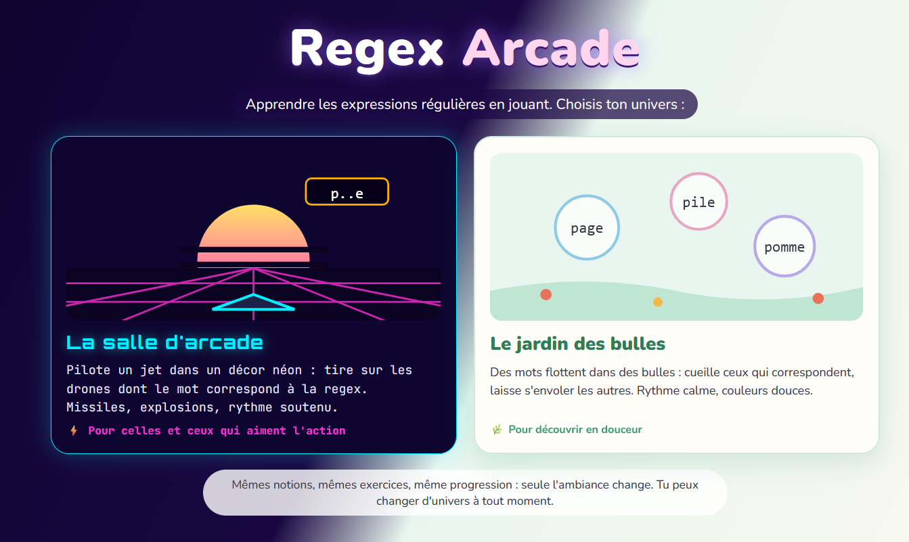
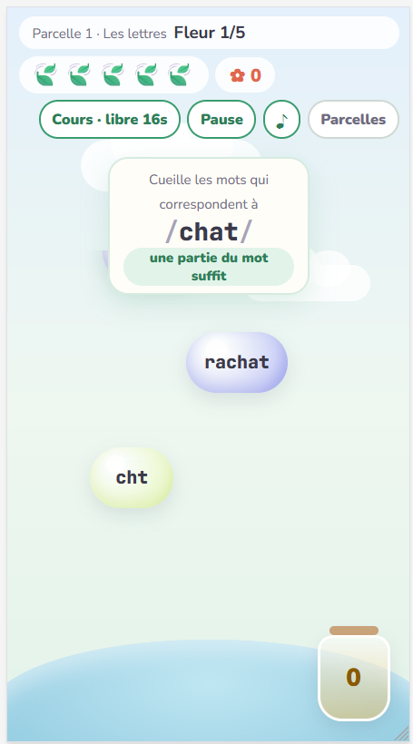
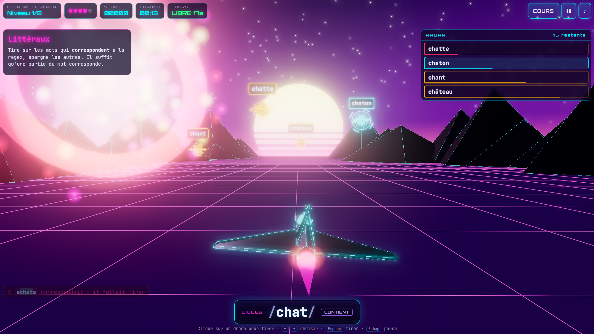
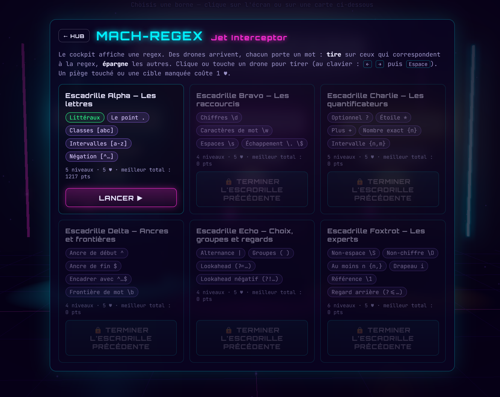

# Regex Arcade

**▶ Démo en ligne : <https://fxpar.github.io/regex-edu-games/>**

Accès direct : [salle d'arcade](https://fxpar.github.io/regex-edu-games/?univers=arcade) · [jardin des bulles](https://fxpar.github.io/regex-edu-games/?univers=jardin)

Apprendre les expressions régulières en jouant. Une notion par niveau, un cours d'une carte, des vies à gérer.

L'accueil propose deux univers, pour des publics différents, avec **les mêmes niveaux** :

- **La salle d'arcade** : salle néon en 3D (Three.js) dont chaque borne est un mini-jeu ; Mach-Regex est un jeu de tir rapide en jet.
- **Le jardin des bulles** : version douce, claire et lente. Des mots flottent dans des bulles : on cueille ceux qui correspondent.



100 % côté client : HTML, CSS et JavaScript (modules ES), sans étape de build ni serveur applicatif.
Déployable tel quel sur GitHub Pages.

## Lancer en local

Le jeu doit être servi par un serveur web, même local : UwAmp, WAMP, XAMPP, l'extension Live Server de VS Code, etc.
Il suffit de placer le dossier dans le répertoire web (par exemple `UwAmp/www/`) et d'ouvrir `http://localhost/regex-edu-games/`.

**Sans rien installer, avec Firefox (version 153 ou plus)** : le « mode local » des outils de développement sert lui-même les fichiers en https.

- *Ponctuellement* : ouvrir `index.html` (double-clic), ouvrir les outils de développement (`F12`, ou clic droit → *Inspecter*), puis cliquer sur **Essayer** dans le bandeau qui apparaît en haut. La page est rechargée depuis une adresse https et le jeu démarre. Ce réglage disparaît à la fermeture des outils de développement.
- *Une fois pour toutes* : dans les outils de développement, ouvrir les **Paramètres** (`F1`), section *Mode local*, et ajouter le dossier du jeu. Firefox le sert alors à une adresse fixe (par défaut en `firefox.localhost`) chaque fois que les outils de développement sont ouverts.

Voir la [documentation de Mozilla sur le mode local](https://firefox-source-docs.mozilla.org/devtools-user/local_mode/index.html).

**Autre solution**, si Python est installé :

```bash
python -m http.server 8765
```

puis ouvrir <http://localhost:8765>.

Pourquoi un serveur ? Ouvert par un simple double-clic (adresse en `file://`), le navigateur bloque le chargement
des modules JavaScript et du fichier `data/missions.json` : le jeu reste sur « CHARGEMENT… ».

Paramètres d'adresse utiles en classe :

- `?univers=arcade` ou `?univers=jardin` : ouvre directement un univers, sans passer par l'accueil (lien à donner à un groupe d'élèves) ;
- `?unlock=all` : débloque toutes les escadrilles et parcelles pour la session, sans l'enregistrer.

Ils se combinent : `?univers=jardin&unlock=all`.

## Déployer sur GitHub Pages

1. Pousser le dépôt sur GitHub.
2. Dans *Settings → Pages*, choisir *Deploy from a branch*, branche `main`, dossier `/ (root)`.
3. Le jeu est servi à `https://<compte>.github.io/regex-edu-games/`.

Three.js est chargé depuis jsDelivr via un `importmap`, il n'y a rien à installer.

## Le jardin des bulles



- Les 6 escadrilles deviennent des **parcelles**, chaque niveau une **fleur** à faire éclore.
- La regex est affichée sur un panneau ; des bulles montent lentement (16 s au début, 12 s à la fin), 2 à 4 à la fois.
- **Cueillir** une bulle (clic, doigt, ou `Tab` + `Entrée`) : si le mot correspond, il rejoint le bocal ; sinon, −1 feuille 🍃 et la raison s'affiche.
- Une bonne bulle **manquée repasse une fois** plus tard. Une bulle-piège qui s'envole rapporte quelques points et affiche sa raison.
- La fleur éclot si au moins **70 %** des bons mots sont cueillis ; sinon on la réessaie, sans perdre ses feuilles.
- Comme dans l'arcade : 5 feuilles par parcelle, cours libre 30 s puis payant (1 feuille), bilan des erreurs, +1 feuille pour une fleur sans faute.
- Pas de musique, sons doux, thème clair (police Nunito, couleurs pastel).
- Pensé aussi pour le téléphone : on cueille du doigt.

<br clear="all">

## La salle d'arcade



| Borne | État | Principe |
|---|---|---|
| **Mach-Regex : Jet Interceptor** | jouable | Le cockpit affiche une regex ; on tire sur les mots qui correspondent, on épargne les autres. |
| Regex Forge | en développement | Remplacements (`\1`, sauts de ligne…). |
| Cellar Scan | en développement | — |

### Mach-Regex : règles

- **28 niveaux en 6 escadrilles** (Alpha → Foxtrot), une notion par niveau : des littéraux jusqu'au regard arrière `(?<=…)`. Terminer une escadrille débloque la suivante.
- **Mode du niveau**, affiché dans le cockpit :
  - **MOT ENTIER** : le mot doit correspondre du premier au dernier caractère (comme `^(?:regex)$`) ;
  - **CONTIENT** : il suffit qu'une partie du mot corresponde (utilisé pour les ancres `^ $` et `\b`).
- **Tirer sur une cible** (mot qui correspond) : des points, plus s'il est loin.
- **Toucher un piège** (mot qui ne correspond pas) : −1 vie, et la raison s'affiche (« trop de lettres pour le point »…).
- **Laisser passer une cible** : −1 vie. Laisser passer un piège : +25 points et la raison s'affiche.
- **Difficulté progressive** : d'un niveau à l'autre, plus de drones, plus rapides, et moins de cibles parmi eux (de 60 % à 35 %). Dans un même niveau, les cibles arrivent plutôt au début et les pièges plutôt à la fin, de plus en plus vite et parfois par deux.
- **Cours** : la fiche (2 lignes, la regex, un exemple qui correspond, un piège) s'affiche au début de chaque niveau. Elle est libre pendant 30 s, puis chaque consultation coûte 1 vie (bloquée à la dernière vie).
- **Vies** : 5 par escadrille ; un niveau sans faute en rend une. À 0, l'escadrille recommence depuis son premier niveau.
- **Bilan** : à la fin de chaque niveau, la liste des erreurs avec leur explication.



### Commandes

| Action | Souris | Clavier | Écran tactile |
|---|---|---|---|
| Viser | survoler un drone | `←` `→` | — |
| Tirer | cliquer sur le drone (ou sa ligne du radar) | `Espace` ou `Entrée` | toucher le drone ou sa ligne du radar |
| Pause | bouton ❚❚ | `Échap` | bouton ❚❚ |
| Cours | bouton **COURS** | `Échap` pendant les 30 s gratuites | bouton **COURS** |

## Structure

```
index.html            écrans (hub, escadrilles, jeu), HUD, modale
css/style.css         thème néon, HUD, version mobile (< 760 px)
css/garden.css        accueil et thème doux du jardin (n'altère pas le thème néon)
data/missions.json    configuration, mini-jeux, escadrilles et niveaux (communs aux deux univers)
js/main.js            chargement, rendu partagé, navigation entre écrans (accueil, arcade, jardin)
js/garden-game.js     le jardin des bulles : bulles, cueillette, feuilles, parcelles (DOM, sans 3D)
js/missions.js        préparation des niveaux, correspondance, vagues et difficulté
js/hub.js             salle d'arcade 3D et bornes cliquables
js/jet-game.js        mini-jeu Jet Interceptor : boucle, visée, drones, missiles, vies, chrono
js/regex-engine.js    compilation des regex, surlignage, coloration syntaxique
js/ui.js              modale, toasts, fiche de cours, mémo
js/textures.js        textures dessinées sur canvas (étiquettes, réticule, écrans)
js/audio.js           effets sonores et musique synthétisés (WebAudio)
js/storage.js         progression dans localStorage
tests/validate-missions.mjs   vérification automatique des niveaux
docs/screenshots/     captures d'écran du README (univers-écran.png)
```

## Ajouter un jeu

Chaque jeu est un module qui expose `scene`, `enter()`, `exit()`, `update(dt)` et `resize(w, h)` ; `main.js` l'active avec `app.activate(jeu)`.
Un jeu sans 3D met `scene = null` : le canvas Three.js est alors masqué et rien n'est rendu. Les niveaux se lisent dans `app.data.levels`,
et `js/missions.js` fournit la correspondance (`levelMatcher`) et le tirage des vagues (`buildWave`).

## Ajouter ou modifier un niveau

Les niveaux sont dans `data/missions.json`, regroupés par escadrille :

```json
{
  "id": "1-2",
  "notion": "Le point .",
  "regex": "p..e",
  "flags": "",
  "mode": "entier",
  "cours": ["Le point . remplace exactement UN caractère.", "p..e : un p, deux caractères, puis un e."],
  "exemple": { "mot": "pâte", "explication": "p, puis â et t, puis e." },
  "cibles": ["page", "pile", "…"],
  "pieges": [{ "mot": "pages", "raison": "5 lettres : un caractère de trop" }]
}
```

- `mode` : `entier` ou `contient` ; `flags` est facultatif (par exemple `"i"`).
- Au moins 12 cibles et 12 pièges, 16 caractères au plus ; chaque piège a une `raison` courte.
- Le jeu en tire une vague au hasard à chaque partie. La difficulté se calcule d'après la place du niveau ; un objet `"difficulte"` peut la forcer (`drones`, `targetRatio`, `travel`, `spawnEvery`, `doubleChance`).

Après une modification, lancer la vérification : chaque cible doit correspondre, chaque piège être refusé.

```bash
node tests/validate-missions.mjs
```

## Moteur de regex

Le jeu utilise les regex JavaScript. Attention : sans drapeau `u`, `\w` et `\b` ne connaissent que les lettres sans accent (é n'est pas un `\w`), ce que plusieurs niveaux exploitent.

## Licence

MIT — voir [LICENSE](LICENSE).
